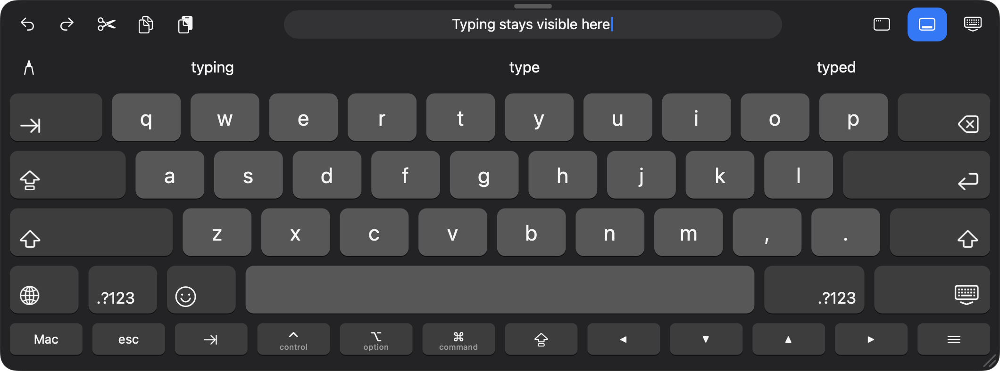
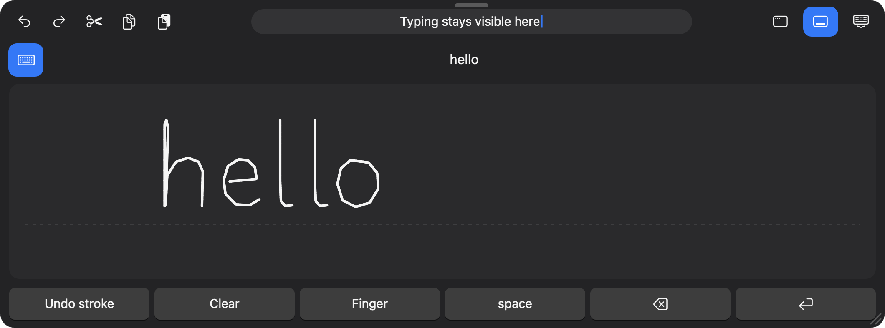

  

# Sidecar On-Screen Keyboard

**An iPad-style Mac keyboard for Sidecar, with Apple Pencil handwriting, predictive text, touch editing tools and easier-to-tap window controls.**

Use Mac apps more comfortably from your iPad through Sidecar. Type with your fingers, write in a dedicated Apple Pencil pad, use Mac keyboard shortcuts, copy and paste with touch controls, and enlarge the Mac's small window buttons when you need them.

[**Download the latest release**](https://github.com/danny67999/sidecar-on-screen-keyboard/releases/latest) · [Setup](#installation) · [Build from source](BUILDING.md) · [License](#source-and-license)

## Typing and Mac keys

- **Automatic appearance:** The keyboard appears when you select a supported text field on the chosen Sidecar display. Turn automatic appearance off and use **Show Keyboard** from the menu bar when you prefer manual control.
- **iPad-style alphabet layout:** Familiar staggered letter rows, Tab, Backspace, Caps Lock, left and right Shift, Return, paired number-page keys, emoji/input-source controls, punctuation and a large spacebar. A separate Mac accessory row keeps the letters roomy.
- **Compact layout:** An alternative desktop-style arrangement combines letters, numbers and Mac controls in a smaller layout.
- **Mac modifiers and shortcuts:** Command, Option, Control, Shift, Escape, Tab, Caps Lock and arrows remain available. Hold a modifier while tapping another key, including multitouch combinations, or tap it to latch it for the next key.
- **Additional key pages:** Open numbers, punctuation, more symbols, a full numeric keypad, F1–F20, Home, End, Page Up, Page Down and forward Delete. The Mac page also offers media playback, volume, display/keyboard brightness, Spotlight, Mission Control, input-source switching and the emoji picker. System controls depend on the Mac and its configuration.
- **Visible press feedback:** Keys highlight and compress when pressed, then animate back on release.
- **Hold to repeat:** Hold letters, Backspace and navigation keys for repeated input. Repeating stops on release or when the target field changes.
- **Tooltips:** Hover a mouse or a Pencil that delivers hover events over controls for explanations and shortcut hints. The Snap tooltip explains whether docking is enabled and how to dock.

## Predictive text and a live typing preview

**Predictive text** adds up to three tappable macOS word suggestions above the keys. These include system word completions and available inline predictions, with dictionary completion as a fallback. Tap a suggestion to insert it; a completed word at the end of the field is followed by a space. Existing following whitespace is preserved.

Suggestions are generated by macOS, so language support, system settings and the target app's Accessibility support affect availability. They can be switched off independently under **Settings → Writing**.

The optional **live typing preview** shows text around the cursor in the middle of the top toolbar. It helps when the keyboard covers the original text box and follows cursor movement rather than maintaining a separate typing history. Turn it off under **Settings → Keyboard**. Recognized password/protected fields are excluded from preview and prediction.

## Apple Pencil handwriting / draw to type

Tap the **pencil button below the toolbar** to replace the keys with a large handwriting pad. Write with an Apple Pencil on a compatible iPad connected through Sidecar.

- **Automatic insertion:** Pause after writing a word or phrase. The recognized text is inserted into the original field with a trailing space, so you can continue with the next word without tapping every result.
- **Review before inserting:** Turn off **Insert handwriting automatically** under **Settings → Writing** to review the recognized text and tap it to insert instead. A space is added in this mode too.
- **Pen input and ink:** AppKit tablet input supports available Pencil pressure and tilt. Visible strokes are smoothed while the original stroke data is retained for recognition. A mouse can also draw in the pad.
- **Optional finger drawing:** The pad's **Finger** button enables or disables finger strokes. It starts off, reducing unwanted marks from direct touch while writing with Pencil.
- **Pad controls:** Undo the last stroke, clear the pad, insert Space, delete with Backspace, or press Return. The keyboard button returns to normal keys.
- **Destination protection:** The app locks the original application, window, field and selection. Handwriting temporarily activates the keyboard app for cursor control, keeping Settings and Setup out of the foreground. Before inserting, it returns to the captured window and rechecks the field. A changed app, invalid field, closed/minimized window or changed selection cancels the pending insertion.
- **On-device recognition:** Apple's PencilKit recognizer processes strokes, with on-device Vision text recognition as a fallback. No account, external AI subscription or handwriting upload is required.

Handwriting and automatic insertion have separate switches under **Settings → Writing**. Recognition accuracy and supported languages depend on macOS and the writing. This is a pad inside the Mac keyboard app; it does not enable iPad Scribble directly inside arbitrary Mac text fields.

## Touch Copy, Select All, Paste and other editing actions

The top toolbar provides **Undo, Redo, Cut, Copy and Paste** with familiar editing icons. These send the standard Mac shortcuts to the focused app.

When text is selected in a supported field on the iPad display, an optional floating editing menu appears near the selection with **Cut, Copy, Paste and Select All**. Select All selects the entire field so you can replace or copy its contents. Make the initial selection using the target app's normal selection tools; the helper adds larger editing actions afterward.

Turn the floating menu on or off with **Settings → Touch Helpers → Selection menu**. Copy and paste work through the Mac clipboard; this app does not collect clipboard contents or keep a clipboard history.

## Larger traffic lights and touch app menus

Tap the Mac window's native traffic-light cluster once to reveal larger **Close, Minimize and Zoom** buttons, then choose the larger button to perform its action. Only the traffic-light area triggers this helper, so title bars and browser tab strips remain available to the app.

The keyboard's **Window** button is another way to open window controls. The **Menus** key opens a larger interface for browsing supported app menu-bar commands. Window controls and touch app menus have independent settings under **Touch Helpers**.

## Move, resize, snap and make room for the keyboard

- **Move:** Drag the handle at the top of the keyboard.
- **Resize:** Drag the resize handle/edges. Position and size are remembered per display, with reconnection matching for a returning Sidecar display.
- **45% default height:** The default keyboard uses about 45% of the display's available height, giving the alphabet and Mac rows more room. You can resize it afterward.
- **Snapping starts on:** Drag the top handle toward the **top or bottom edge** and release when the docking highlight appears. Use the Snap button next to Hide to toggle snapping; turning it off floats the keyboard. The new default is enabled once on upgrade, and later deliberate on/off choices are remembered.
- **Optional app fitting:** With **Fit app around docked keyboard** enabled, supported resizable app windows are fitted above or below the docked keyboard and restored afterward. Full-screen windows, application minimum sizes and manual adjustments can limit fitting.
- **Reset:** Use **Reset Size & Position** from the menu bar or the Reset button in Settings to return to the default geometry.

## Menu bar, appearance and settings

The menu-bar **On/Off switch** pauses or resumes the keyboard and touch helpers without quitting. Turning the app off hides its overlays, stops key repeat, clears in-memory writing/preview state and restores fitted windows.

The menu also includes Show/Hide Keyboard, Window Controls, Reset Size & Position, Setup Guide, Settings and Quit. The Setup Guide helps with Accessibility permission and display selection.

Choose **Match System, Light or Dark** appearance. Optional **Hide after Return** dismisses the keyboard after a plain Return/Enter; Shift-Return keeps it open. Automatic appearance, preview, prediction, handwriting, handwriting auto-insertion, enlarged window controls, selection menus, app menus and app fitting can be controlled separately.

## Requirements

- An **Apple Silicon Mac running macOS 27 or later**.
- A Sidecar-compatible iPad running **iPadOS 27 or later** for finger interaction.
- An active Sidecar connection and a selected display in the app.
- macOS **Accessibility permission** for detecting fields and sending input.
- A compatible **Apple Pencil** for Pencil writing; finger or mouse drawing is also available in the pad.

No separate iPad companion app is required.

## Installation

1. Download the **arm64 DMG** from [Releases](https://github.com/danny67999/sidecar-on-screen-keyboard/releases/latest), under **Assets**.
2. Open the DMG and drag **Sidecar On-Screen Keyboard.app** to **Applications**. The app ZIP is also available if preferred.
3. Open it and follow the Setup Guide.
4. Enable its Accessibility permission in System Settings.
5. Connect your iPad through Sidecar, then choose the iPad display in the app.
6. Tap a supported Mac text field on that display. Type with the keyboard or open the Pencil pad.

Official app downloads are **Developer ID signed and notarized by Apple**. Each release includes SHA-256 checksums and the corresponding source ZIP. A locally compiled or modified app has its own signing/notarization status.

## Privacy and compatibility

The app has **no built-in analytics, typing history, clipboard collection or network upload**. Preview and predictions retain a short in-memory text excerpt; turning both off stops field-value reads. Ink and recognition results are kept in memory and cleared when you leave the pad, hide/disable the keyboard or invalidate the destination. Recognized secure/protected fields are excluded from preview, prediction and handwriting insertion.

Field detection, selection menus, app menus, text replacement and window fitting depend on each application's Accessibility implementation. Predictions may be absent in unsupported fields. Corrections need settable text-selection support; safe matching completion suffixes can also work without it. The keyboard displays US key legends, while ordinary key interpretation follows the Mac's active input source. Dictation and swipe typing are not included.

See [Security and privacy](SECURITY.md) and [Third-party notices](THIRD_PARTY_NOTICES.md).

## Feedback

Report bugs through [GitHub Issues](https://github.com/danny67999/sidecar-on-screen-keyboard/issues). Include the app version, macOS/iPadOS versions, affected app and steps to reproduce. Do not post passwords or private writing samples.

## Source and license

Source is available for personal, noncommercial study, use, modification and sharing under the **[Noncommercial Source-Available License 1.0](LICENSE)**.

**Commercial use requires the copyright holder's prior written permission. This includes paid work, business operations, selling copies, paid services and using the code in commercial products.** Redistributed versions/modifications must include corresponding source under the same terms.

[Browse version 1.1 source](https://github.com/danny67999/sidecar-on-screen-keyboard/tree/v1.1) or [download its source ZIP](https://github.com/danny67999/sidecar-on-screen-keyboard/releases/download/v1.1/Sidecar-On-Screen-Keyboard-1.1-source.zip). See [Building from source](BUILDING.md).

These are source-available terms, **not an OSI-approved open-source license**. Public source does not grant commercial permission. Contact the project owner through this repository for separate written terms.

*This independent project is not affiliated with or endorsed by Apple.*
